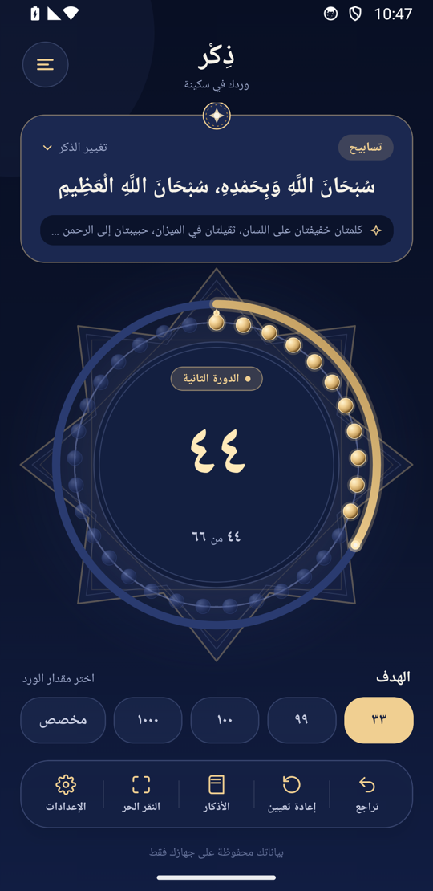

# ذِكْر — Zekr

مسبحة إلكترونية عربية تحفظ العدّ والإعدادات على الجهاز، بلا إعلانات أو اشتراكات أو حسابات أو تحليلات أو خادم خلفي.

[English والتوثيق الكامل](README.md) · [خط الأساس المتحقق منه](docs/PROJECT_BASELINE.md) · [سجل بناء Android](docs/ANDROID_RELEASE.md)



**نوع الدليل:** صور أصلية لملف APK الموقّع بوضع release على محاكي Android 14/API 34، مصغّرة بنسبة ٥٠٪ للتوثيق. [طريقة الالتقاط والتتبع](docs/assets/screenshots/android/README.md). [صور المتصفح المنفصلة واختباراته](docs/assets/screenshots/README.md) محفوظة مع توصيفها الصحيح.

**خط أساس للتطوير، وليس إصدارًا عامًا.** ملف APK الداخلي مخصص للتحقق من البناء والاختبار على الأجهزة الفعلية؛ ما زالت هناك مزايا مخططة قبل الإطلاق الأول.

## المزايا الحالية

- مكتبة من عشرة أذكار عربية مع النص والفضل والتصنيف ومراجع مختصرة.
- عدّ مستمر، و٣٣ خرزة في كل دورة بصرية، وأهداف تراكمية تتقدم تلقائيًا.
- أهداف جاهزة ٣٣ و٩٩ و١٠٠ و١٠٠٠، وهدف مخصص من ١ إلى ٩٩٩٩.
- تراجع، وتأكيد إعادة ضبط العدّاد أو الإحصائيات.
- النقر الحر يشارك الشاشة الرئيسية نفس العدّ والهدف والإعدادات.
- ستة مظاهر محفوظة محليًا؛ عددها في المعرض والإعدادات مشتق من سجل المظاهر.
- إعدادات الاهتزاز والمؤثرات، واحترام تقليل الحركة، وتسميات عربية لإتاحة الوصول.
- حماية من القراءة الفاشلة أو البيانات التالفة، وكتابات تخزين متسلسلة، وتنبيه عند تعذر الحفظ مع إعادة المحاولة.

عند العدّ **٤٤** والهدف الأساسي **٣٣**، تظهر **٤٤ من ٦٦**، وتضيء ١١ خرزة من ٣٣، ويمتلئ ثلث قوس الفترة الحالية. لا يتوقف العدّ عند اكتمال الهدف ولا يحتاج إلى زر دورة تالية. تغيير المظهر يحافظ على العدّ؛ تغيير الذكر يتبع مسار التأكيد الحالي ويبدأ عدّ الذكر المختار وهدفه الافتراضي.

## المظاهر الستة

| المظهر | المعرّف الثابت | صور Android الأصلية |
| --- | --- | --- |
| ياقوت الليل — Midnight Sapphire | `midnightSapphire` | [الرئيسية](docs/assets/screenshots/android/tasbeeh-midnight-sapphire.png) · [النقر الحر](docs/assets/screenshots/android/free-tap-midnight-sapphire.png) |
| الجمشت الملكي — Royal Amethyst | `royalAmethyst` | [الرئيسية](docs/assets/screenshots/android/tasbeeh-royal-amethyst.png) · [النقر الحر](docs/assets/screenshots/android/free-tap-royal-amethyst.png) |
| العاجي الهادئ — Soft Ivory | `softIvory` | [الرئيسية](docs/assets/screenshots/android/tasbeeh-soft-ivory.png) · [النقر الحر](docs/assets/screenshots/android/free-tap-soft-ivory.png) |
| جمر الليل — Obsidian Ember | `obsidianEmber` | [الرئيسية](docs/assets/screenshots/android/tasbeeh-obsidian-ember.png) · [النقر الحر](docs/assets/screenshots/android/free-tap-obsidian-ember.png) |
| طيف الجليد — Glacier Prism | `glacierPrism` | [الرئيسية](docs/assets/screenshots/android/tasbeeh-glacier-prism.png) · [النقر الحر](docs/assets/screenshots/android/free-tap-glacier-prism.png) |
| نبض الشمس — Solar Pulse | `solarPulse` | [الرئيسية](docs/assets/screenshots/android/tasbeeh-solar-pulse.png) · [النقر الحر](docs/assets/screenshots/android/free-tap-solar-pulse.png) |

[شاهد مجموعة الصور كاملة](README.md#six-themes-in-the-real-application)، بما فيها المعرض والإعدادات واختيار الذكر والهدف المخصص. معاينات بطاقات المعرض تستخدم عينة ثابتة ١٢/٣٣ وليست عدّ المستخدم.

## التشغيل والفحص

المشروع يستخدم Expo SDK 57 وReact Native 0.86.3 وReact 19.2.3 وTypeScript وAsyncStorage. يتطلب Node.js 22.13 أو أحدث وnpm.

```sh
npm ci
npm start
npm test
npx tsc --noEmit
npm run lint
npx expo-doctor
```

نجح تشغيل ١٨ أكتوبر ٢٠٢٦: ٥٧ اختبار وحدة/محوّل تخزين، وفحص الأنواع وLint، و٢١ من ٢١ فحص Expo Doctor. اختبارات المتصفح منفصلة عن التحقق الأصلي على الأجهزة؛ [تعليمات إعادة التشغيل والتقاط الصور](docs/assets/screenshots/README.md).

## Android وحالة الإصدار

إصدار التطبيق **0.1.0**، ورقم بناء Android **1**، والمعرّف **app.dhikr.counter**. الفرع الأساسي المعتمد هو **master** حسب طلب المالك. الإصدار `1.0.0` في package.json يخص بيانات حزمة npm فقط.

```sh
npx eas-cli@latest build --platform android --profile preview
```

ملف `preview` مخصص لـAPK داخلي بوضع release، ومشروع EAS مملوك لحساب `ayosry`. [نتيجة البناء وتفاصيل التتبع](docs/ANDROID_RELEASE.md). لا يوجد إصدار عام أو اعتماد متجر أو نشر على Google Play ضمن هذه المهمة.

نجح الفحص الأصلي الأساسي على Android 14، بما فيه استعادة المظاهر بعد إيقاف العملية. يظل التحقق على الأجهزة الفعلية وإصدارات Android الأخرى وiOS وشاشة البداية وقارئات الشاشة والاهتزاز الفعلي مطلوبًا. قد تغطي لوحة المفاتيح أزرار حوار الهدف المخصص على Android 14 حتى تُخفى. كما أن فقدان العملية قد يسبق اكتمال الحفظ. بعض النصوص الثانوية الباهتة في المظاهر الداكنة أقل من نسبة التباين 4.5:1؛ هذه المراجعة لا تدعي امتثالًا كاملًا لإتاحة الوصول.

تكوين Android الداخلي/الإنتاجي يحظر إذن الإنترنت وأذونات الوسائط/التخزين المحددة، بينما يسمح تكوين التطوير باتصال Metro. لا يُستنتج من ذلك أن البيان النهائي خالٍ من جميع الأذونات.

يوجد [ترخيص MIT](LICENSE) مع إشعار حقوق Expo الأصلي كما هو. حُفظت الصور التصميمية والتقارير القديمة كأدلة تاريخية؛ [جرد الصور](docs/IMAGE_AUDIT.md).

## اعتبارات ما قبل الإصدار العام

التطبيق مقصود أن يكون متاحًا مجانًا بهدف خيري. ستُراجع هوية المطور ونسب العمل وصفحة «عن ذِكْر» وبيانات الدعم والترخيص ووثائق الخصوصية في عمل منفصل، مع المزايا المخططة قبل الإطلاق. هذه اعتبارات موثقة فقط، ولم تُنفذ ضمن التوحيد الحالي.
