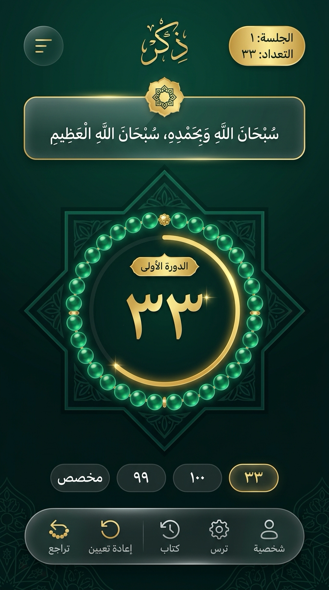
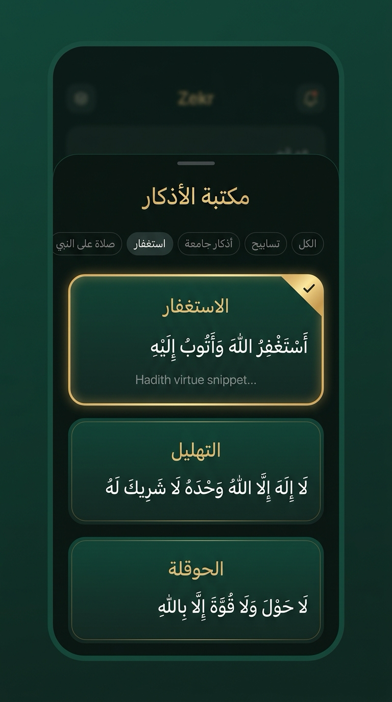
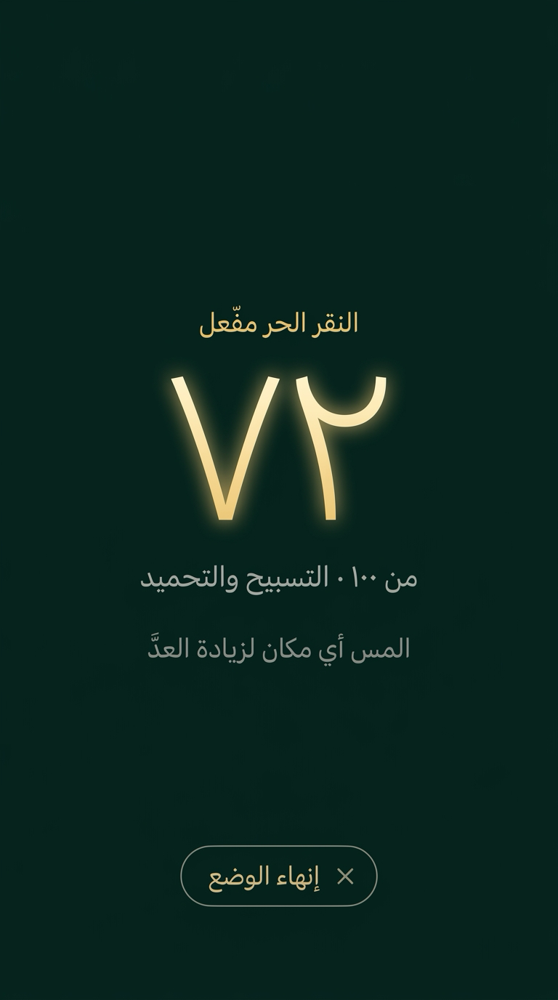

<div align="center">

  

  # ذِكْر — Zekr

  ### مسبحة إلكترونية هادئة ورفيق للذكر والسكينة
  **A Serene, Privacy-First Islamic Tasbeeh & Dhikr Mobile Companion**

  <p align="center">
    <b>العربية</b> • <a href="./README.md">English (الإنجليزية)</a>
  </p>

  <p align="center">
    <a href="#-معاينة-التطبيق">معاينة التطبيق</a> •
    <a href="#-عن-تطبيق-ذكر">عن التطبيق</a> •
    <a href="#-أبرز-المزايا">أبرز المزايا</a> •
    <a href="#-مكتبة-الأذكار-وفضائلها-المأثورة">مكتبة الأذكار والفضائل</a> •
    <a href="#-التقنيات-المستخدمة">التقنيات</a> •
    <a href="#-التثبيت-والتشغيل-محليا">التشغيل والتثبيت</a> •
    <a href="#-هيكلية-المشروع">الهيكلية</a> •
    <a href="#-الخصوصية-والميثاق-الأخلاقي">الخصوصية</a>
  </p>

  [](https://expo.dev/)
  [](https://reactnative.dev/)
  [](https://react.dev/)
  [](https://www.typescriptlang.org/)
  [](./LICENSE)
  [](#-الخصوصية-والميثاق-الأخلاقي)

</div>

---

> 🌍 **اختر لغة القراءة:**
> - [**العربية (Arabic)**](./README.ar.md) (الصفحة الحالية)
> - [**English (الإنجليزية)**](./README.md)

---

## 🎨 الرؤية التصميمية والمعاينة الفنية (Design Preview)

> [!NOTE]
> الصور أدناه تمثل التصميمات المرجعية والرؤية الفنية (Design Previews & Concept Mockups) التي توجّه الهوية البصرية للتطبيق. يُترجم التطبيق هذه المفاهيم في بيئة التشغيل الفعلية عبر رسوميات SVG المتجهة وخطوط النظام المعتمدة وتخطيطات متجاوبة.

<div align="center">
  <table>
    <tr>
      <td align="center">
        
        <br />
        <sub><b>حلقة التسبيح وحبات المسبحة (معاينة تصميمية)</b><br />Main Tasbeeh Ring (Design Preview)</sub>
      </td>
      <td align="center">
        
        <br />
        <sub><b>مكتبة الأذكار وفضائلها (معاينة تصميمية)</b><br />Dhikr Library & Virtues (Design Preview)</sub>
      </td>
      <td align="center">
        
        <br />
        <sub><b>وضع النقر في كامل الشاشة (معاينة تصميمية)</b><br />Eyes-Free Tap HUD (Design Preview)</sub>
      </td>
    </tr>
  </table>
</div>

---

## 📖 عن تطبيق «ذِكر»

**ذِكر (Zekr)** هو تطبيق إسلامي للهواتف المحمولة مفتوح المصدر بالكامل، صُمم بعناية فائقة ليكون رفيقك الهادئ في ذكر الله ومسبحتك اليومية.

يجمع التطبيق بين **جماليات الفن الإسلامي والهندسة المقدسة**، والتفاعل اللمسي الفيزيائي الحديث عبر محركات الاهتزاز والأنيميشن الانسيابي، مع الالتزام الصارم بعدم الاتصال بالإنترنت والخصوصية المطلقة.

> *«أَلَا بِذِكْرِ اللَّهِ تَطْمَئِنُّ الْقُلُوبُ»* — سورة الرعد (٢٨)

---

## ✨ أبرز المزايا

### 📿 ١. حلقة تسبيح تفاعلية مع ٣٣ حبة مسبحة ضوئية
- **حبات المسبحة الإلكترونية (33 Luminous Beads)**: حلقة محيطية مكونة من ٣٣ حبة تستلهم المسبحة التقليدية؛ تُضاء الحبات تباعًا حبة بحبة مع كل تسبيحة (في دورة مسبحة من ٣٣ تسبيحة)، بينما يعكس القوس الذهبي الداخلي نسبة إنجاز الهدف الكلي.
- **تفاعل لمسي حركي (Micro-Animations)**: ارتداد فيزيائي سلس عند الضغط (`Animated.spring`) مع موجة ضوئية رقيقة وقفزة في رقم العداد.
- **احتفال الختم والتمام**: نبض ضوئي هادئ وتنبيه اهتزازي لطيف عند بلوغ الهدف المطلوب مع إمكانية بدء الدورة التالية بنقرة واحدة.

### 🌟 ٢. خلفية هندسية إسلامية (خاتم سليمان الزخرفي)
- نجمة إسلامية ثمانية الأضلاع (*Islamic 8-Point Star*) مرسومة بمتجهات SVG فائقة الدقة مع إشعاع هادئ باللون الزمردي والذهبي، تضفي على الواجهة وقارًا وسكينة.

### 📚 ٣. مكتبة أذكار مأثورة بالتشكيل والتوثيق الحديثي
- نصوص قرآنية ونبوية مشكولة بالكامل بدقة متناهية.
- توثيق فضل كل ذكر ومصدره من كتب الحديث الصحيحة (*متفق عليه، رواه البخاري، رواه مسلم*).
- مصنفة في أبواب: *(تسابيح، أذكار جامعة، استغفار، صلاة على النبي)*.

### 🔁 ٤. نظام الختمات والدورات والإحصائيات التراكمية
- تتبع رقم الدورة الحالية (*الدورة الأولى، الدورة الثانية...*).
- عدّاد تراكمي يحفظ مجموع ما ذكرت به ربك على الجهاز.
- عرض الأرقام بالمنازل والفاصلة العربية الأصيلة (*١،٢٥٠*).

### 📱 ٥. وضع النقر في كامل الشاشة (Free Tap Mode)
- إمكانية لمس أي مكان على الشاشة لزيادة العدّ دون الحاجة للنظر إلى الهاتف، وهو خيار رائع أثناء المشي أو الخلوات الليلية.

### 📳 ٦. اهتزاز لمسي مخصص (Haptics Feedback)
- استجابة حسية متقنة عبر محرك الاهتزاز (`expo-haptics`) تفرّق بين النقرة العادية ولحظة إتمام الهدف.

### 🌌 ٧. تجربة إطلاق أصلية متعمدة (Native Launch)
- شاشة الإطلاق في النسخة الإنتاجية تستخدم خلفية Midnight Sapphire ثابتة ورمزًا شفافًا مستوحى من المسبحة والهندسة الإسلامية؛ وتعرض iOS هوية `ذِكْر` الكاملة، بينما يستخدم Android 12+ الرمز المركزي فقط وفق قيود شاشة النظام.
- لا تختفي شاشة الإطلاق إلا بعد جاهزية المظهر المحفوظ وحالة العداد، لتنتقل مباشرة إلى أول إطار فعلي دون تأخير مصطنع.

### 🔒 ٨. خصوصية تامة وبدون إنترنت بنسبة ١٠٠٪
- خالي تمامًا من أي إعلانات أو تتبع أو تحليلات.
- لا يطلب أي صلاحيات إنترنت أو وسائط.
- يُحفظ تقدمك محليًا بالكامل داخل جهازك عبر `AsyncStorage`.

---

## 📖 مكتبة الأذكار وفضائلها المأثورة

| الذكر المبارك | نص الذكر بالتشكيل | الفضل والمصدر من السنة النبوية | الهدف الافتراضي |
| :--- | :--- | :--- | :--- |
| **التسبيح والتحميد** | سُبْحَانَ اللَّهِ وَبِحَمْدِهِ، سُبْحَانَ اللَّهِ الْعَظِيمِ | «كلمتان خفيفتان على اللسان، ثقيلتان في الميزان، حبيبتان إلى الرحمن» *(متفق عليه)* | **١٠٠** |
| **الاستغفار** | أَسْتَغْفِرُ اللَّهَ وَأَتُوبُ إِلَيْهِ | كان النبي ﷺ يستغفر الله ويتوب إليه في اليوم أكثر من سبعين مرة *(رواه البخاري)* | **١٠٠** |
| **التسبيح** | سُبْحَانَ اللَّهِ | من سبّح مئة تسبيحة كُتبت له ألف حسنة أو حُطّت عنه ألف خطيئة *(رواه مسلم)* | **١٠٠** |
| **التحميد** | الْحَمْدُ لِلَّهِ | «والحمد لله تملأ الميزان» *(رواه مسلم)* | **٣٣** |
| **التكبير** | اللَّهُ أَكْبَرُ | أحب الكلام إلى الله أربع: سبحان الله، والحمد لله، ولا إله إلا الله، والله أكبر *(رواه مسلم)* | **٣٣** |
| **التهليل** | لَا إِلَهَ إِلَّا اللَّهُ وَحْدَهُ لَا شَرِيكَ لَهُ، لَهُ الْمُلْكُ وَلَهُ الْحَمْدُ، وَهُوَ عَلَى كُلِّ شَيْءٍ قَدِيرٌ | من قالها مئة مرة كانت له عدل عشر رقاب، وكُتبت له مائة حسنة، ومُحيت عنه مائة سيئة، وحرزًا من الشيطان *(متفق عليه)* | **١٠٠** |
| **الحوقلة** | لَا حَوْلَ وَلَا قُوَّةَ إِلَّا بِاللَّهِ | «كنز من كنوز الجنة» *(متفق عليه)* | **١٠٠** |
| **الصلاة على النبي** | اللَّهُمَّ صَلِّ وَسَلِّمْ عَلَى نَبِيِّنَا مُحَمَّدٍ | «من صلى عليّ صلاة واحدة صلى الله عليه بها عشرًا» *(رواه مسلم)* | **١٠٠** |
| **الباقيات الصالحات** | سُبْحَانَ اللَّهِ، وَالْحَمْدُ لِلَّهِ، وَلَا إِلَهَ إِلَّا اللَّهُ، وَاللَّهُ أَكْبَرُ | قال ﷺ: «لأن أقولها أحبّ إليّ مما طلعت عليه الشمس» *(رواه مسلم)* | **٣٣** |
| **سيد الاستغفار** | اللَّهُمَّ أَنْتَ رَبِّي لَا إِلَهَ إِلَّا أَنْتَ، خَلَقْتَنِي وَأَنَا عَبْدُكَ، وَأَنَا عَلَى عَهْدِكَ وَوَعْدِكَ مَا اسْتَطَعْتُ، أَعُوذُ بِكَ مِنْ شَرِّ مَا صَنَعْتُ، أَبُوءُ لَكَ بِنِعْمَتِكَ عَلَيَّ، وَأَبُوءُ بِذَنْبِي فَاغْفِرْ لِي، فَإِنَّهُ لَا يَغْفِرُ الذُّنُوبَ إِلَّا أَنْتَ | من قالها من النهار موقنًا بها فمات من يومه قبل أن يمسي فهو من أهل الجنة *(رواه البخاري)* | **١** (صباحًا ومساءً) |

---

## 🛠️ التقنيات المستخدمة

| التقنية / المكتبة | الإصدار | دورها في التطبيق |
| :--- | :--- | :--- |
| **Expo SDK** | `~57.0` | بيئة التطوير والبناء السريعة والمستقرة |
| **React Native** | `0.86.3` | إطار بناء الواجهات الأصلية للهواتف |
| **React** | `19.2.3` | محرك إدارة الحالة والمكونات |
| **TypeScript** | `~6.0` | كتابة كود صارم وموثوق خالي من الأخطاء |
| **React Native SVG** | `15.15.4` | رسم الزخارف الهندسية، حبات المسبحة والأيقونات |
| **Expo Linear Gradient** | `~57.0` | تدرجات متناسقة مع المظاهر الثلاثة |
| **Expo Haptics** | `~57.0` | محرك ردود الفعل والاهتزازات اللمسية |
| **Expo Splash Screen** | `~57.0` | إعداد شاشة الإطلاق الأصلية والانتقال إلى التطبيق |
| **AsyncStorage** | `2.2.0` | التخزين المحلي غير المشفر لبيانات العداد على الجهاز |

---

## 🚀 التثبيت والتشغيل محليًا

### المتطلبات الأساسية
- تثبيت **Node.js** (إصدار 22.13 أو أحدث)
- تطبيق **Expo Go** على هاتفك ([iOS App Store](https://apps.apple.com/app/expo-go/id982107779) / [Google Play](https://play.google.com/store/apps/details?id=host.exp.exponent))، أو محاكي iOS / Android.

### خطوات التشغيل

1. **استنساخ المستودع (Clone):**
   ```bash
   git clone https://github.com/amu3dev/Zekr.git
   cd Zekr
   ```

2. **تثبيت الاعتماديات (Install Dependencies):**
   ```bash
   npm install
   ```

3. **تشغيل خادم التطوير (Start Dev Server):**
   ```bash
   npx expo start
   ```

4. **المعاينة:**
   - امسح رمز الـ **QR Code** الظاهر في الطرفية عبر كاميرا الهاتف أو تطبيق Expo Go.
   - أو اضغط على حرف `i` لتشغيل محاكي iOS، وحرف `a` لتشغيل محاكي Android.

> لا يعكس Expo Go أو إصدار التطوير شاشة الإطلاق الإنتاجية. للتحقق من التصميم وسلوك Android 12 استخدم إصدار Preview أو Production أصليًا.

### أوامر الفحص والتحقق
```bash
# فحص الأنواع الصارم عبر تايب سكريبت
npx tsc --noEmit

# تشخيص سلامة إعدادات بيئة إكسبو
npx expo-doctor
```

---

## 📂 هيكلية المشروع

```
Zekr/
├── assets/                       # أيقونات التطبيق وصور البداية (Splash & Icons)
├── src/
│   ├── components/
│   │   ├── CounterRing.tsx       # حلقة تسبيح متكيفة مع الهدف وحبات المسبحة والأنيميشن
│   │   ├── IslamicGeometry.tsx   # الزخرفة الهندسية الإسلامية وشعاع النور
│   │   ├── Icons.tsx             # منظومة الأيقونات المتجهية SVG
│   │   └── Modals.tsx            # مكتبة الأذكار، تحديد الهدف، والإعدادات والمظهر
│   ├── arabic.ts                 # معالجة الأرقام العربية والترتيب اللفظي للدورات
│   ├── counter.ts                # منطق العداد، مكتبة الأذكار، وإدارة الحالة (Reducer)
│   ├── storage.ts                # حفظ واسترجاع الحالة محليًا عبر AsyncStorage
│   ├── theme.ts                  # رموز دلالية للهويات البصرية الثلاث
│   └── ThemeProvider.tsx         # اختيار المظهر واستعادة التفضيل محليًا
├── App.tsx                       # الشاشة الرئيسية وتكامل الواجهة والتحكم
├── app.json                      # إعدادات تطبيق إكسبو والصلاحيات
├── index.ts                      # نقطة الدخول الرئيسية للتطبيق
├── package.json                  # الاعتماديات وأوامر التشغيل
└── tsconfig.json                 # ضبط مترجم TypeScript
```

---

## 🔒 الخصوصية والميثاق الأخلاقي

- **صدقة جارية (Sadaqah Jariyah)**: هذا المشروع غير ربحي ومفتوح المصدر وخالٍ للأبد من أي إعلانات تجارية مزعجة تشتت روحانية الذكر.
- **انعدام الصلاحيات الحساسة (Zero Permissions)**: لا يطلب التطبيق ولا يحتاج أي صلاحيات للوصول إلى الموقع، الكاميرا، الميكروفون، أو جهات الاتصال.
- **بياناتك لك وحدك**: لا توجد خوادم خارجية، ولا يتم إرسال أي معلومة أو إحصائية خارج جهازك مطلقًا.

---

## 🤝 المساهمة في المشروع

نرحب بمساهمات المطورين لتحسين الأداء أو إضافة أذكار مأثورة وصحيحة:

1. قم بعمل **Fork** للمستودع.
2. أنشئ فرعًا جديدًا لميزتك (`git checkout -b feature/amazing-feature`).
3. تأكد من اجتياز الفحص البرمجي: `npx tsc --noEmit`.
4. ارفع التغييرات (`git commit -m 'feat: Add new authentic dhikr'`).
5. ادفع الفرع وافتح طلب سحب (**Pull Request**).

---

## 📄 الترخيص

هذا المشروع مرخص تحت رخصة **MIT License** — طالع ملف [LICENSE](./LICENSE) للتفاصيل.

<div align="center">
  <sub>صُنع بإحسان ليكون عونًا على ذكر الله في كل وقت وحين 🌿</sub>
</div>
