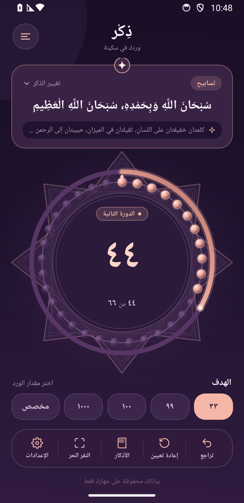
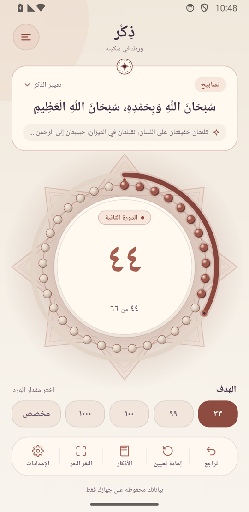
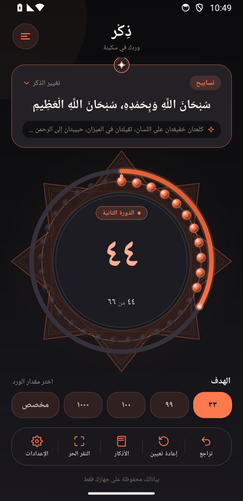
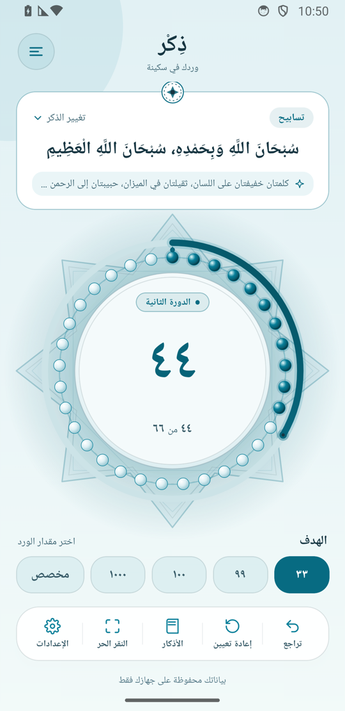
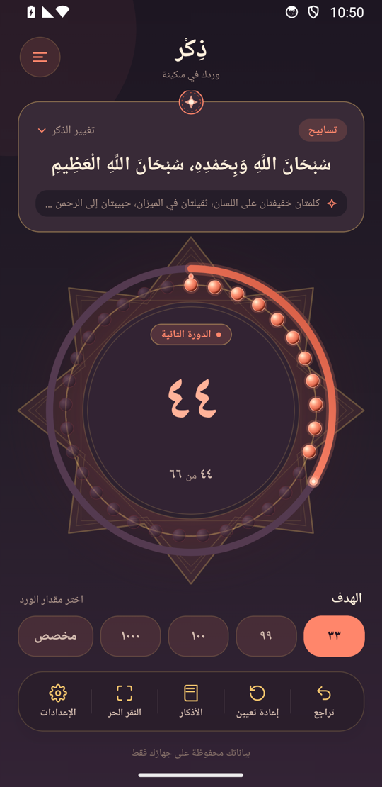
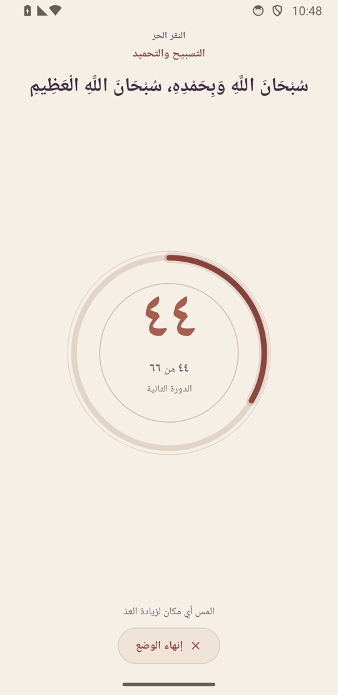
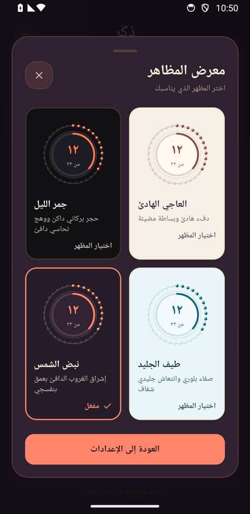

<div align="center">


# Zekr — ذِكْر

مسبحة إلكترونية عربية، بهدوء وخصوصية، تحفظ العدّ والإعدادات محليًا.

An Arabic-first, offline tasbeeh app built with Expo and React Native.

**Development baseline — not publicly released.** The internal APK supports build validation and physical-device QA; planned features remain before the first public release.

[العربية](README.ar.md) · [Verified project baseline](docs/PROJECT_BASELINE.md) · [Android build record](docs/ANDROID_RELEASE.md)
</div>

<p align="center"></p>

**Screenshot evidence:** the signed release APK running on a Pixel 3a Android 14/API 34 emulator. Native captures are uniformly resized from 1080 × 2220 to 540 × 1110 for documentation. [Native capture provenance](docs/assets/screenshots/android/README.md). Separate [browser captures and QA](docs/assets/screenshots/README.md) are retained and labelled.

## What the application does

- Arabic dhikr library with ten entries, phrases, categories and virtue/source summaries.
- Continuous counting with exactly 33 beads per visual cycle and automatic goal milestones.
- Preset goals of 33, 99, 100 and 1000; custom goals from 1 to 9999, including Arabic/Persian digit input.
- Undo, confirmed session reset, aggregate count and confirmed statistics reset.
- Free Tap mode shares the same count, goal and settings as the main screen.
- Six selectable themes, saved locally; gallery and Settings counts derive from the theme registry.
- Haptic and visual-effect settings, system reduced-motion handling, and Arabic accessibility labels.
- Guarded storage initialization, corruption/read-failure protection, serialized writes, retry and visible save-failure feedback.
- **التسبيحات الكاملة — Guided Dhikr Routines:** four locally sourced prayer/bedtime routines, automatic step changes, boundary undo, completion correction and saved resume. [Definitions, verified sources, statistics and QA](docs/GUIDED_ROUTINES.md).

Behavior is covered by unit/browser tests and native Android 14 release smoke checks, including all six themes and saved restoration after force-stop. Physical haptics, TalkBack/VoiceOver, unacknowledged-write durability and production splash transitions still require further validation. No ads, subscriptions, accounts, analytics or backend are implemented. Preview/production Android configuration blocks Internet and media/storage permissions; development permits Metro access. This is not a claim that the final merged Android manifest has zero permissions.

## Counting and milestones

The chosen **base target stays unchanged**. At count **44**, base target **33**:

- The cumulative label reads **٤٤ من ٦٦**.
- The milestone interval is **11 of 33**, so the outer arc is one-third full.
- **11 of the 33 beads** are active, in bead cycle two.

At exactly 66, the arc is full and a brief completion acknowledgment appears. Tap 67 continues immediately toward 99. Counting never requires a Next Round button. Base target 1 uses ordinary tap feedback without repeated completion announcements. Changing the dhikr uses the existing confirmation flow and starts that dhikr's count/default target; changing a theme preserves count.

## Six themes, in the real application

Every main and Free Tap capture below uses the same dhikr, count 44, base 33, milestone 66, with visual effects disabled. Gallery preview cards intentionally show their separate static sample of 12/33.

| Midnight Sapphire · ياقوت الليل | Royal Amethyst · الجمشت الملكي | Soft Ivory · العاجي الهادئ |
| --- | --- | --- |
| <br>`midnightSapphire` | <br>`royalAmethyst` | <br>`softIvory` |
| **Obsidian Ember · جمر الليل** | **Glacier Prism · طيف الجليد** | **Solar Pulse · نبض الشمس** |
| <br>`obsidianEmber` | <br>`glacierPrism` | <br>`solarPulse` |

## Free Tap, gallery and dialogs

Free Tap provides a large counting surface and an explicit exit control. Leaving it preserves progress. The gallery applies a theme immediately and remains open for browsing.

<p>


</p>

[All six Main/Free Tap pairs](docs/assets/screenshots/android/README.md#theme-captures) · [Initial gallery](docs/assets/screenshots/android/theme-gallery-initial.png) · [Settings and six-theme indicator](docs/assets/screenshots/android/settings-solar-pulse.png) · [Dhikr selection](docs/assets/screenshots/android/dhikr-selection.png) · [Custom target](docs/assets/screenshots/android/custom-target.png) · [Milestone completion](docs/assets/screenshots/android/milestone-33-completion.png)

## Technology

| Component | Current version / role |
| --- | --- |
| Expo | `~57.0.30` |
| React Native / React | `0.86.3` / `19.2.3` |
| TypeScript | `~6.0.3`, strict mode |
| AsyncStorage | `2.2.0`, unencrypted local state |
| react-native-svg | `15.15.4`, bead ring and geometry |
| Expo modules | Haptics, Linear Gradient, Splash Screen, Status Bar |

The existing app has one root `App.tsx`, local modal state, a counter reducer, shared persistence owners and a theme context. It does not currently use Expo Router. No navigation migration is included in this baseline.

## Install and develop

Node.js 22.13 or newer and npm are required; the repository uses `package-lock.json`.

```sh
git clone https://github.com/amu3dev/Zekr.git
cd Zekr
npm ci
npm start
```

Use an SDK-compatible Expo Go installation for development, or a native development build. `npm run android` selects the development configuration with Metro network access. Expo Go does not verify production splash behavior. The package's web command is not a supported production web target: browser QA installs its web dependencies separately.

`master` remains the canonical branch by owner request. Preserve existing work, inspect remote changes before synchronization, and obtain approval before committing or publishing changes.

## Validate

```sh
npm test
npx tsc --noEmit
npm run lint
npx expo-doctor
```

The 18 October 2026 run passed 57 unit/adapter tests, TypeScript, lint and 21/21 Doctor checks. Browser suites cover milestone journeys plus 378 component cases, 13 persistence scenarios, launch behavior and all six themes.

```sh
npm run test:milestones
npm run test:persistence
npm run test:launch
npm run test:themes
npm run test:baseline
npm run test:routines
```

Browser commands require a separate QA runtime. See [reproduction instructions](docs/assets/screenshots/README.md); they use isolated test storage and mocked native services. Results and limitations are recorded in the [baseline](docs/PROJECT_BASELINE.md).

Guided routines are a later local feature extension of the baseline. The initial implementation passed 73 unit/adapter tests and 28 routine browser scenario groups; its presentation has since received a focused recovery. [Current compact layout, before/after captures and validation status](docs/routines-ui/README.md) cover all six themes, narrow phones and enlarged text. The earlier Android APK/screenshots above do not contain routines; native routine QA remains pending.

## Android builds and current status

App version **0.1.0**, Android versionCode **1**, application ID **app.dhikr.counter**. The npm package version `1.0.0` is package metadata, not the installed app version.

```sh
# Internal, release-mode installable APK; requires authorized EAS account access.
npx eas-cli@latest build --platform android --profile preview

# Store-oriented AAB; this command does not submit to Google Play.
npx eas-cli@latest build --platform android --profile production
```

The EAS project is owned by `ayosry`; preview uses internal distribution and EAS-managed Android signing. [Current build outcome, provenance and remaining release gates](docs/ANDROID_RELEASE.md). No public release, version tag or Google Play submission has been created by this consolidation.

## Known limitations

- Android 14 release smoke checks passed. Other Android versions, physical devices and iOS remain unverified in this run; splash transitions, launcher masking, screen readers, haptics and performance need further native QA.
- Native process termination can interrupt unsaved writes; retry and background flushing do not guarantee crash-proof durability.
- Main content and counters passed the inspected browser layouts and standard-font Android 14 captures. Maximum OS text scaling, very narrow devices and extreme safe-integer-length labels need native QA.
- On the tested Android 14 keyboard, custom-goal action buttons can be covered until the keyboard is dismissed. This is an observed native layout limitation, not documentation drift.
- Faint secondary text in several dark themes remains below 4.5:1 in selected token checks; passing existing contrast tests is not full accessibility conformance. [Exact measurements](docs/validation/theme-contrast.json).
- Historical concept art and dated remediation reports are retained as historical material, outside this current showcase. [Image audit](docs/IMAGE_AUDIT.md).

## Before the first public release

Planned product features remain; their requirements will be defined separately. Developer attribution, About Zekr, support contact details, licensing/attribution and privacy documentation need a dedicated review. The intended product is freely available with a charitable purpose. These are pre-release considerations, not implemented features or a release announcement. See the [development baseline](docs/PROJECT_BASELINE.md#pre-release-product-considerations).

## License

An [MIT LICENSE](LICENSE) exists in the repository and retains its existing Expo copyright notice. This consolidation does not change or invent attribution.
